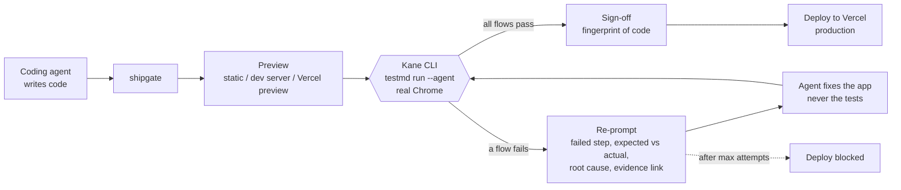

<div align="center">

# ▌ship gate

**Your coding agent doesn't get to ship until Kane CLI says it works.**

Ship Gate is a deploy gate for AI-written code. It runs your plain-English user flows in a real browser with [Kane CLI](https://github.com/LambdaTest/kane-cli). When a flow fails, Ship Gate turns Kane's verdict into a precise re-prompt and hands it back to your coding agent. The agent fixes the code, Kane runs the flows again, and the deploy to Vercel only happens once every flow passes.

`verify → fail → re-prompt agent → fix → re-verify → pass → deploy`

</div>

---

## Why

Coding agents say "done" when the code compiles and the unit tests are green. Users find out about the cart that shows `$04.503.00`. Ship Gate makes a real browser run the release condition and puts the agent in charge of getting there:

- **Kane CLI is the judge.** Tests are `*_test.md` files written in plain English. Kane drives Chrome, checks each step, and records expected vs actual values, a root cause, bug triage and an evidence link.
- **The agent gets the failure, not a red X.** The re-prompt names the failed step, what the step asked for, what was on the page, the element Kane read, and Kane's root-cause guess.
- **Deploys are locked to a sign-off.** Passing writes `.shipgate/signoff.json` with a fingerprint of the code. `shipgate deploy` refuses if anything changed after Kane signed off.
- **Any agent.** It works with a local model, Claude Code, Codex, Gemini CLI, Cursor Agent, aider, any MCP client, or any command that reads a prompt on stdin.

## How the loop works



1. **Preview.** Ship Gate serves your build (built-in static server on a free port), starts your dev command, or points at an existing preview URL.
2. **Verify.** Each `*_test.md` runs through `kane-cli testmd run --agent --headless`. Ship Gate parses Kane's NDJSON stream: `test_md_step_*`, `run_end` (reason, `reason_code`, verdict root cause, `context.memory` assertions), `test_md_bug_verdict`, `test_md_adaptive_heal`, and the evidence pack and Test Manager link.
3. **Re-prompt.** If a flow fails, Ship Gate writes `reprompt.md` (for the agent) and `reprompt.json` (for tools), then hands it to the configured agent.
4. **Fix.** The agent edits files in place. Ship Gate snapshots the sources before and after, saves `fix.diff`, and rejects any edit to `*_test.md` or to anything outside the project.
5. **Re-verify.** Kane replays the steps that were recorded and passed from its cache, so a re-check costs a fraction of the first run. It re-authors the steps that fail.
6. **Ship.** If every flow passes, Ship Gate writes the sign-off and deploys. If attempts run out, the deploy stays blocked and the last re-prompt is kept.

## What a re-prompt looks like

This came from a real run on the demo app in [`examples/brew-bar`](examples/brew-bar). Nothing was edited.

```markdown
## FAILED: tests/order_total_test.md

- **Failed step:** 3 "Check the cart total"
- **What the step asks for:**
  > Verify the element with data-testid "cart-total" shows exactly "$7.50".
- **Kane saw:** The cart contains a $4.50 latte and a $3.00 croissant, but the displayed total is malformed rather than $7.50.
- **Kane's root cause:** The total display is joining the item prices together instead of adding them as money amounts.
- **Reason code:** `assertion_error.confirmed_product_bug`
- **Assertion failed:** the element with data-testid "cart-total" shows exactly "$7.50"
  - expected: `$7.50`
  - actual on the page: `$04.503.00`
  - element: `internal:testid=[data-testid="cart-total"s]` read via `el(23).textContent`
- **Kane bug triage:** application_issue/ui_data_defect, severity major, confidence 0.98
- **Evidence (Kane Test Manager):** https://test-manager.lambdatest.com/…
```

Full logs from real runs are in [`docs/demo-run.md`](docs/demo-run.md) and [`docs/runs/`](docs/runs). Live demo, deployed by `shipgate` itself after Kane signed off: **https://shipgate-brew-bar.vercel.app**

## Quick start

Requirements: Node 18+, Google Chrome, and a [TestMu AI](https://www.testmuai.com/kane-cli/) account.

```bash
npm i -g @testmuai/kane-cli          # Kane CLI
kane-cli login                       # once
npm i -g github:yohunshadow/shipgate # Ship Gate (not on npm: the `shipgate` name there belongs to an unrelated package, so don't use `npx shipgate`)

cd your-app
shipgate init --claude               # config + example flow + Claude Code hook (or --codex)
$EDITOR tests/smoke_test.md          # describe what users do, in plain English
shipgate                             # verify → fix → re-verify → deploy
```

To try the demo, which has a bug planted on purpose:

```bash
git clone https://github.com/yohunshadow/shipgate && cd shipgate/examples/brew-bar
shipgate --agent claude      # or: shipgate --agent-cmd "codex exec --full-auto -"
                             # or: the built-in agent with a local model (see below)
git checkout -- app/cart.js  # put the bug back
```

## Commands

| Command | What it does |
|---|---|
| `shipgate` | The full loop: verify, then re-prompt, fix and re-verify up to `maxAttempts` times, then deploy on pass |
| `shipgate verify` | One Kane pass with no fixing. Exits 0 on pass and writes the sign-off. Exits 1 and prints the re-prompt when blocked (good for CI) |
| `shipgate verify --hook claude` | Claude Code `Stop` hook mode, see below |
| `shipgate deploy` | Deploys only if the sign-off fingerprint matches the current code |
| `shipgate reprompt` | Prints the last re-prompt |
| `shipgate mcp` | MCP server with the tools `shipgate_verify` and `shipgate_deploy` |
| `shipgate init [--claude] [--codex]` | Scaffolds the config, an example flow, and the agent wiring |

Flags: `--agent <type>`, `--agent-cmd "<cmd>"`, `--max-attempts <n>`, `--no-deploy`, `--url <preview-url>`, `--config <file>`, `-C <dir>`.

## Agents

| Agent | How Ship Gate talks to it | Status |
|---|---|---|
| `builtin` | Sends the re-prompt and project sources to any **OpenAI-compatible** endpoint (Ollama, LM Studio, vLLM, OpenAI, Groq, OpenRouter, …). The model answers with SEARCH/REPLACE blocks, and Ship Gate applies them with guards. | **Used for the recorded demo**: `qwen2.5-coder:7b` on local Ollama, CPU only |
| `claude` | `claude -p --permission-mode acceptEdits`, with the re-prompt on stdin | preset |
| `codex` | `codex exec --full-auto -` | preset |
| `gemini` | `gemini --yolo` | preset |
| `cursor-agent` | `cursor-agent -p --force "<re-prompt>"` | preset |
| `aider` | `aider --yes-always --message-file <re-prompt>` | preset |
| `command` / `--agent-cmd` | Any shell command. The re-prompt goes to stdin, its path is substituted for `{prompt_file}`, and it is also in `$SHIPGATE_REPROMPT_FILE` | generic |

To point the built-in agent at a model:

```bash
export SHIPGATE_LLM_BASE_URL=http://localhost:11434/v1   # default (Ollama)
export SHIPGATE_LLM_MODEL=qwen2.5-coder:7b
export SHIPGATE_LLM_API_KEY=...                           # only for hosted endpoints
```

### The agent drives Ship Gate instead

- **Claude Code `Stop` hook** ([`integrations/claude-code`](integrations/claude-code)). Whenever Claude tries to finish, the hook runs Kane. If a flow fails, the hook exits with code 2 and puts the re-prompt on stderr, so Claude keeps working on that exact failure. It is capped at `maxAttempts`.
- **Codex / any agent with `AGENTS.md`** ([`integrations/codex`](integrations/codex)): run `shipgate verify`, fix whatever it reports, and repeat.
- **MCP** ([`integrations/mcp`](integrations/mcp)): `shipgate_verify` returns PASS or the re-prompt with `isError: true`.
- **CI** ([`integrations/github-action.yml`](integrations/github-action.yml)): `shipgate verify` blocks the PR and uploads `.shipgate/` as an artifact.

## Config

`shipgate.config.json`:

```json
{
  "tests": ["tests"],
  "preview": { "static": "app", "port": 5199 },
  "agent": { "type": "builtin", "model": "qwen2.5-coder:7b", "include": "app" },
  "maxAttempts": 3,
  "deploy": { "provider": "vercel", "prod": true },
  "kane": { "headless": true, "timeout": 420, "onLockConflict": "readonly" }
}
```

- `preview` can be `{ "static": "dist" }`, `{ "command": "npm run dev", "url": "http://localhost:3000" }`, or `{ "url": "https://preview.example.com" }`.
- `deploy.provider` is one of:
  - `vercel`: uses the REST API when `VERCEL_TOKEN` is set (`deploy.project`, `deploy.teamId` or `VERCEL_TEAM_ID`, `deploy.dir`; waits for READY and prints the production alias), otherwise the logged-in `vercel` CLI. With neither, Ship Gate stops at **deploy-ready**.
  - `command`: runs any script, with the sign-off JSON in `$SHIPGATE_SIGNOFF`.
  - `none`
- `kane.onLockConflict` is passed to `kane-cli --on-lock-conflict` (`readonly`, `fail` or `wait`). Test Manager allows one playground session per account; with another session open, `readonly` still runs every step locally but skips the Test Manager upload link, and `wait` polls every 30 seconds until the lock frees.

## What Kane CLI does here

- Runs every flow in a real Chrome browser from plain-English steps. There are no selectors to maintain.
- Records every step on the first passing run, and **replays from cache** after that. On the demo app, the steps that were already recorded replay in about 1.4 seconds.
- Runs an **adaptive heal** when a replay misses, so Ship Gate can tell a real product bug from a flaky locator. The re-prompt says which one happened.
- Reports structured verdicts: `reason_code` (for example `assertion_error.confirmed_product_bug`), root cause, bug family and severity, and expected vs actual values with the element it read.
- Seals an **evidence pack** for every run and uploads it to Test Manager. The link goes into the re-prompt, the run log, the sign-off, and the Vercel deployment's metadata.

## Files Ship Gate writes

```
.shipgate/
  signoff.json                       # who signed off, when, code fingerprint, evidence links
  last-reprompt.md
  runs/<id>/
    run.md                           # human-readable log: attempts, Kane verdicts, agent diffs
    report.json
    attempt-1/
      order_total_test.ndjson        # raw Kane stream
      reprompt.md  reprompt.json     # what the agent got
      agent-prompt.md agent-response.md fix.diff
    attempt-2/ …
```

## Limitations (v0.1)

- Ship Gate is web only. Kane can test Android and iOS, but Ship Gate doesn't wire up `--target` yet.
- With a remote `preview.url`, Ship Gate doesn't rebuild the preview between attempts. For the full loop, use `static` or `command`.
- Small local models sometimes answer with a whole file instead of edit blocks. Ship Gate accepts that, but refuses rewrites that look truncated.

## License

MIT © 2026 Yendi Nurdiansyah ([@yohunshadow](https://github.com/yohunshadow)). Built for the [KaneCLI Online Hackathon](https://www.kaneclihack.sh/).
